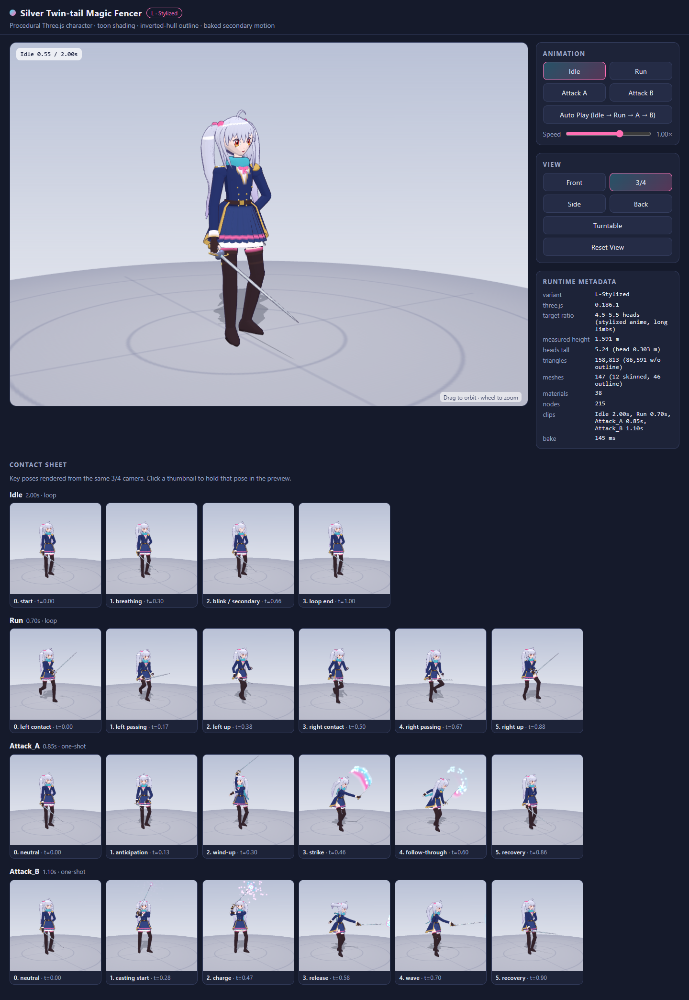

# L-Stylized · Claude Opus 5.5 Three.js Character

L 단독 결과 페이지와 소스입니다. GitHub Pages는 [`docs/`](docs/)를 `main` 브랜치에서 직접 제공합니다.

- **라이브 데모:** https://legerdo.github.io/opus55-anime-threejs-character-action-benchmark-l-20260929/
- **공개 저장소:** https://github.com/Legerdo/opus55-anime-threejs-character-action-benchmark-l-20260929
- **실제 제작 프롬프트:** [PROMPT.md](PROMPT.md)



## 결과

Three.js 코드와 procedural geometry만으로 만든 애니메이션풍 마법검사 캐릭터입니다. 외부 캐릭터 모델, 텍스처, 애니메이션 파일은 사용하지 않았습니다. Three.js 0.186.1 모듈은 `docs/vendor/`에 포함되어 브라우저에서 외부 서버에 요청하지 않습니다.

- 생성 모델: `claude-opus-5.5` (Kiro CLI V3, high effort)
- 목표 비율: 4.5–5.5등신 스타일라이즈드 애니메이션 캐릭터
- 실제 측정: 5.24등신, 높이 1.5909 world units (목표 약 1.60)
- 애니메이션: Idle (2.00초), Run (0.70초), Attack_A (0.85초), Attack_B (1.10초)
- 장면 통계: 147 meshes, 12 skinned meshes, 46 outline meshes, 38 materials, 215 nodes

## 형상 예산 기록

원래 벤치마크의 hard maximum은 60,000 triangles, material maximum은 16개였습니다. L 결과는 outline을 포함해 **158,813 triangles**이며, outline을 제외해도 **86,591 triangles**입니다. Material도 **38개**로 상한을 넘습니다. 이 저장소는 검증된 L 결과를 그대로 보존하며, 이 예산 초과를 통과로 표시하지 않습니다.

## 실행

빌드 단계 없이 정적 파일을 제공합니다. Python 3가 설치된 환경에서 저장소 루트에서 실행하세요.

```powershell
py -m http.server 8765 --directory docs
```

그다음 [http://localhost:8765](http://localhost:8765)를 엽니다. 캐릭터를 드래그해 회전하고 휠로 확대할 수 있습니다. Idle, Run, Attack A/B, 시점 선택, 턴테이블, 속도 조절과 포즈 시트를 사용할 수 있습니다.

## 검증 기록

제작 run에서 headless Chromium으로 로컬 HTTP 페이지를 실행해 확인했습니다.

- HTTP 200, WebGL2 렌더링, JavaScript 오류/경고 없음
- 외부 네트워크 요청 없음
- 4개 애니메이션 clip과 실행 UI, Contact Sheet 확인
- canvas resize 동작 확인
- scene graph를 순회한 geometry 및 높이 측정값을 [`metadata.json`](docs/metadata.json)에 보존
- 검증 시점의 뷰와 포즈 스크린샷은 [`screenshots/`](docs/screenshots/)에 포함

이 저장소는 L 결과 하나만 담으며, 다른 비율 결과나 자동 승자 판정은 포함하지 않습니다.

## 라이선스

프로젝트 코드에 별도 라이선스는 지정하지 않았습니다. 포함된 Three.js 라이선스는 [`docs/vendor/LICENSE`](docs/vendor/LICENSE)에서 확인할 수 있습니다.
